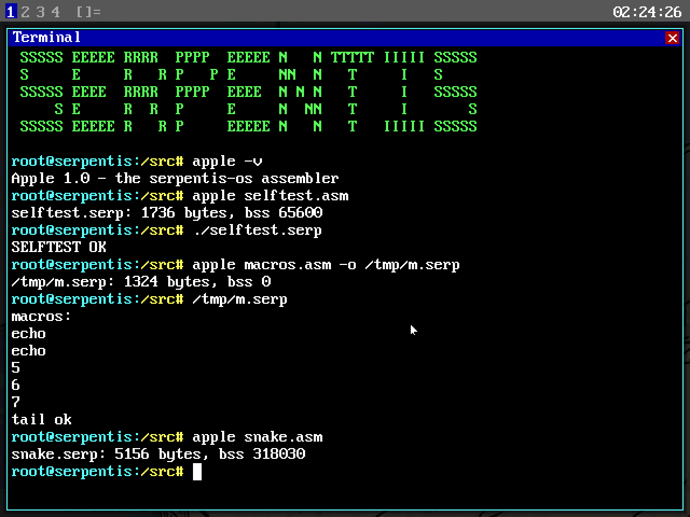
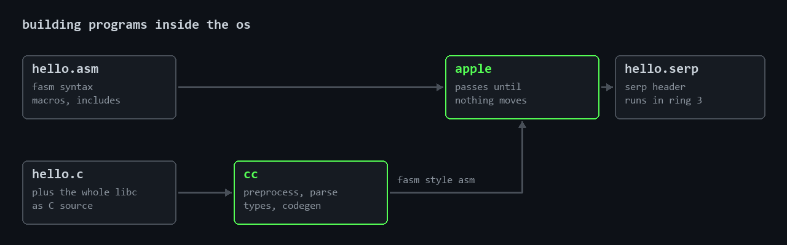

# apple

an x86 64 assembler, written in x86 64 assembly, that runs inside [serpentis-os](https://github.com/serpentis-os/serpentis-os). about 5700 lines. it takes a source file, turns it into machine code and writes a program the serpentis kernel can load and run. it is how the system builds programs without needing another computer

it only runs inside serpentis-os. it reads files and allocates memory through serpentis syscalls and it writes serpentis executables, so there is nothing to start on linux or windows. the way to try it is to boot serpentis-os, apple is in /bin there and its source is in /usr/src/serpentis/assembler

## a first program

    include '/lib/start.inc'

    main:
        lea rdi, [message]
        call print_line
        xor eax, eax
        ret

    message db 'Hello from a program assembled inside Serpentis', 0

    include '/lib/library.inc'

this is /src/hello.asm in the system

    cd /src
    apple hello.asm
    ./hello.serp
    Hello from a program assembled inside Serpentis

start.inc gives you the entry point that calls main and exits with whatever main returns. library.inc gives print_line, print_u64, string helpers and the syscall wrappers. both are plain asm files in /lib that you can read

## what the language looks like

the syntax is fasm's, the parts of it this system actually uses. a short tour

constants and data

    WIDTH = 640
    define HEIGHT 480
    LIMIT equ WIDTH * HEIGHT

    table   dq 1, 2, 3
    name    db 'snake', 0
    buffer  rb 256
            times 16 db 0
            align 8

labels, and local labels that start with a dot and belong to the last normal label, so every function can have its own .loop and .done

    strlen:
        xor eax, eax
    .next:
        cmp byte [rdi + rax], 0
        je .done
        inc eax
        jmp .next
    .done:
        ret

memory operands with any base, index, scale and displacement, and size words when a register doesnt already say the size

    mov rax, [rbx + rcx * 8 + 16]
    mov dword [table + rsi * 4], 7
    movzx eax, byte [rdi]

macros with parameters and local labels, a macro can call other macros

    macro say text
    {
        lea rdi, [text]
        call print_line
    }

    macro sized name, value
    {
        local .start, .stop
        db .stop - .start
    .start:
        db name
    .stop:
        db value
    }

conditional assembly and repeat

    if defined DEBUG & LEVEL > 2
        call dump_registers
    else if LEVEL = 1
        call short_report
    end if

    repeat 8
        db % * 2
    end repeat

constants can come from the command line, apple -D LEVEL=3 -D DEBUG file.asm, and include files are searched next to the source first and then in every -I directory

## how it turns text into bytes

### lexer and expressions

every line is cut into tokens, names numbers strings and punctuation. expressions are parsed by recursive descent, one function per level of precedence. or and xor at the bottom, then and, then shl shr, plus minus, times divide mod, then not and unary minus, then numbers names $ and brackets. the comparisons and the logic that if uses sit on top of that. a value is either known or not known yet, a label further down the file isnt known in the first pass, and that flag travels through the whole expression

### symbols

labels and constants live in one hash table with 8192 slots, fnv-1a over the name and linear probing when two names land on the same slot. a local label is stored under its full name, so .next inside strlen is really strlen.next. every symbol remembers the pass it got its value in, that is how apple tells a final value from a guess left over from the pass before

### macros, if, repeat

these run before a line is ever encoded. a macro call copies the body line by line and puts the arguments in place of the parameters, local names get a fresh suffix on every call so two calls dont fight over the same .start. a false if block still has to be read, because if blocks nest, but its lines are skipped. repeat runs its body as many times as asked with % as the counter

### encoding

the operand parser decides for every operand if it is a register, memory or an immediate, and for memory it works out base, index, scale and displacement. then the handler for the instruction picks the opcode and fills in the reg field and the size, and one routine writes it all out in the right order

    mov rax, [rbx + rcx * 8 + 16]   ->  48 8b 44 cb 10

    48   rex.w, 64 bit operand
    8b   mov reg, r/m
    44   modrm: an 8 bit displacement follows, reg is rax, a sib byte follows
    cb   sib: scale 8, index rcx, base rbx
    10   the displacement, 16

    add r9d, 1                      ->  41 83 c1 01

    41   rex.b, r9 needs the extra register bit
    83   group 1 with an 8 bit immediate, 1 fits so the short form is picked
    c1   modrm: register r9, /0 means add
    01   the immediate

### passes and jump sizes

this is the hard part of every x86 assembler. a jmp is 2 bytes when the target is within 127 bytes and 5 bytes when it is further. how far the target is depends on the size of every jump in between, and those depend on their own targets

    start:
        jmp near_label        eb 64            100 bytes away, short
        times 100 nop
    near_label:
        jmp far_label         e9 c8 00 00 00   200 bytes away, needs the long form
        times 200 nop
    far_label:
        ret

apple assembles the whole file again and again. in the first pass a label it hasnt seen yet counts as close, so jumps start out short. every pass uses the addresses the pass before found, and the jumps that turned out too far grow. when a pass ends and no address moved, one last pass writes the file, and only that pass reports errors, because the earlier ones see a lot of names that simply arent known yet

the trap is how a forward jump measures its distance. its target only has last pass's address, so the jump has to measure from its own address in last pass's layout too. measure from this pass's position against last pass's target and you mix two layouts, and chains of jumps keep flipping between short and long. apple keeps the position and size of every branch from the pass before and measures inside that layout. after 12 passes anything still undecided is made long, so it always finishes

### output

there is no linker and no object files. apple writes the serpentis executable directly, an 80 byte header and then the code

    offset  size  field
    0       4     magic, SERP
    4       2     version
    6       2     flags
    8       8     header size
    16      8     entry point, relative to the code
    32      8     code size
    56      8     bss size, zeroed by the kernel after the code
    64      8     stack size
    72      8     code pages, a sanity check for the loader

## errors

every error has the file and the line and repeats the line, and they only come out in the last pass once it is clear what is really wrong. this is /tests/errors.asm from the test image

    apple /tests/errors.asm
    /tests/errors.asm:4: invalid memory operand
        mov eax, [rbx + rsp*2]
    /tests/errors.asm:5: value out of range
        mov al, 1000
    /tests/errors.asm:6: unknown instruction
        frobnicate eax
    /tests/errors.asm:7: undefined symbol
        jmp missing_label
    /tests/errors.asm:8: invalid expression
        mov eax,
    apple: errors: 5

## is it really the same code fasm makes

the programs in serpentis-os are built with fasm on the host, and their sources are inside the system too. build the editor, the file manager, the clock or the graphing calculator again with apple and compare the two files, they are identical byte for byte. /src/encoding.asm in the system goes through every instruction form apple knows for the same kind of check

## command line

    apple [options] source.asm [output.serp]
      -o FILE          write the output to FILE
      -D NAME[=VALUE]  define a constant, VALUE defaults to 1
      -I DIR           also look for include files in DIR
      -q               print nothing unless something fails
      -v               version

## whats missing and whats not great

only 64 bit code, no use16 or use32. it cant build the boot sector or the loader, those still need fasm

about 150 instructions. the general purpose ones and the scalar sse the system uses, no avx, no x87, no system instructions like lgdt or wrmsr, so it cant build the kernel either

the fasm features this system never needed arent there. struc, virtual, @@ anonymous labels, irp and forward inside macros, postpone, label with a size

only serpentis executables come out, no elf, no pe, no plain binary with your own org

the limits are fixed when apple is built. 64 macros, 8 parameters each, nesting 8 deep, 8192 symbols, 16384 jumps, 2 MB of source

no listing file and no symbol map, debugging the output means reading bytes

it reads the source and every include again on every pass. simple, but slow, the editor takes tens of seconds inside qemu

## the files

    assembler/apple.asm      command line, the pass loop, output, error reporting
    assembler/lexer.inc      tokens
    assembler/expr.inc       expressions
    assembler/symbols.inc    the symbol table
    assembler/macros.inc     macros
    assembler/cond.inc       if, else, end if
    assembler/blocks.inc     repeat
    assembler/operand.inc    operands and addressing
    assembler/encode.inc     instruction encoding and jump sizes
    assembler/tables.inc     every keyword and its handler
    apps/runtime/            the small runtime every serpentis program uses
    include/                 syscall numbers and the executable format
    examples/                programs apple builds inside the os
